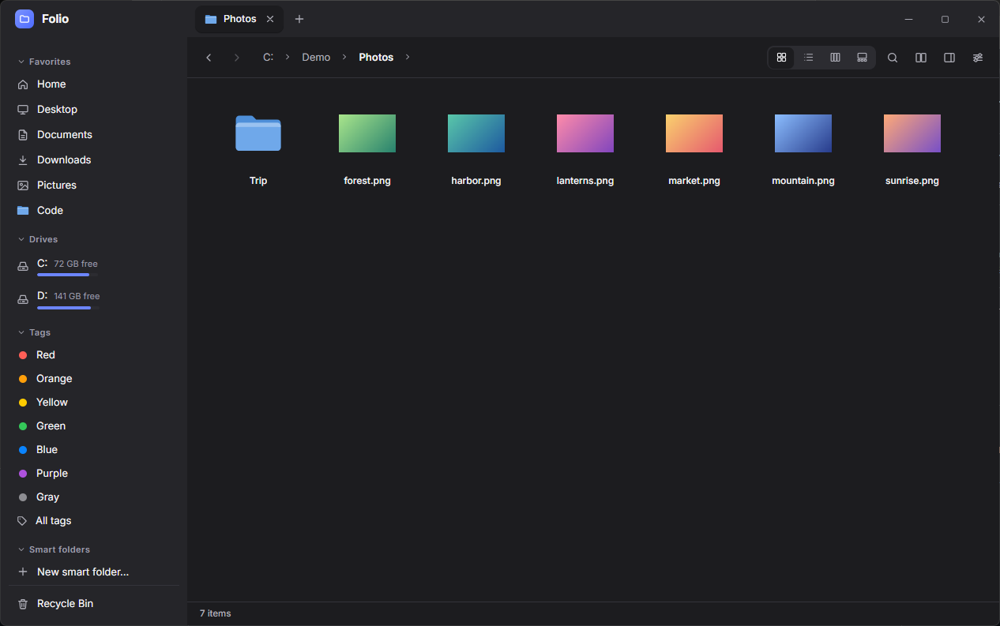
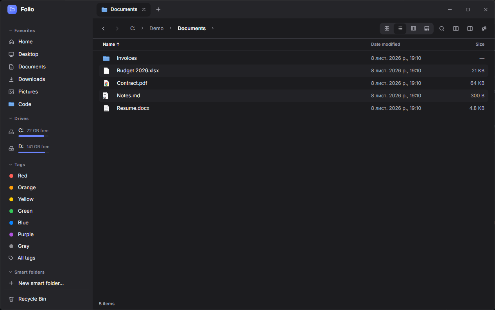
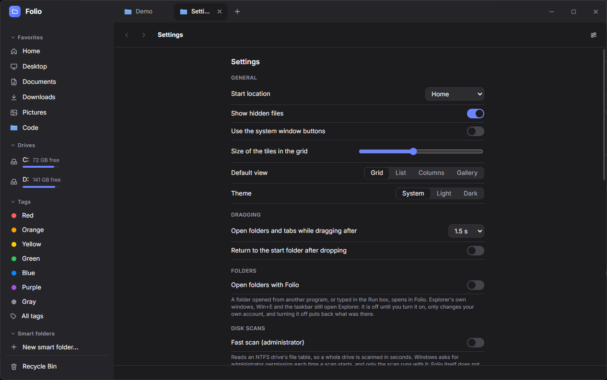

# Folio

**A fast, calm file manager for Windows, macOS and Linux.** Tabs, color tags, undo for file
operations, a space breakdown and safe cleanup, in a Finder-inspired interface. Built with
Tauri, so it starts quickly and stays light on memory.



## Why Folio

- **Never lose a file.** Deletes go to the Recycle Bin or Trash, every move, rename and delete can
  be undone with Ctrl+Z, and a conflict always asks what to do.
- **Feels instant.** Large folders open fast and scroll smoothly; the budgets are written down in
  [Product](docs/PRODUCT.md) and treated as release blockers.
- **Keyboard first, mouse friendly.** Every action has a shortcut, and Ctrl+K opens a command
  palette to jump to folders or run actions.
- **Looks the same everywhere,** while following each system's conventions for paths, trash and
  menus.

## Features

- **Browsing:** grid, list, column and gallery views; tabs that can be dragged out into windows
  and are restored on launch; a sidebar with favorites, drives and tags; a path bar you can
  click or type into; Quick Look (Space) for images, PDFs, text, audio, video and archives; an
  inspector panel; an optional second pane.
- **File operations:** copy and move run in a background queue with progress, pause and cancel.
  Batch rename with a live preview, zip compress and extract, and a clipboard shelf that collects
  Ctrl+X and Ctrl+C across folders and pastes them all at once. Drag and drop works inside Folio
  and with other apps, and hovering a folder mid-drag opens it.
- **Tags:** seven color tags and named tags, filters in the sidebar, smart folders (saved
  searches), and export for a new computer. Finder tags and `user.xdg.tags` are kept in sync on
  macOS and Linux.
- **Storage and cleanup:** a space breakdown (donut and treemap) with drill-down, plus
  suggestions for large and old files, old downloads, duplicates, and temporary files and caches.
  Cleanup only suggests; nothing moves until you review it, and everything goes to the Recycle
  Bin or Trash. On Windows, an opt-in fast scan reads the NTFS file table.
- **Search:** type to filter the current folder, or search a folder tree by name and size.
- **Plugins:** small sandboxed web pages that add actions for selected files
  ([guide](docs/PLUGINS.md)).
- **Open folders with Folio:** an opt-in setting that makes Folio the program other applications
  open folders with. It only changes your own account and is undone when turned off.

|                                                               |                                                      |
| ------------------------------------------------------------- | ---------------------------------------------------- |
|  |            |
| List view with sortable columns                               | Minimal settings, including opening folders in Folio |

## Download

Get the latest build from the [Releases page](https://github.com/naz013/folio-file-manager/releases/latest):

| System  | Package                                                          |
| ------- | ---------------------------------------------------------------- |
| Windows | `.exe` installer                                                 |
| macOS   | `.dmg` (universal: Apple silicon and Intel)                      |
| Linux   | `.AppImage`, `.deb` or `.rpm` (see [Linux notes](docs/LINUX.md)) |

Folio updates itself: it checks for a new version once a day (you can turn this off in Settings)
and installs one only when you say so.

## Documentation

| Doc                                  | What's inside                                            |
| ------------------------------------ | -------------------------------------------------------- |
| [Product](docs/PRODUCT.md)           | Vision, principles, performance budgets, feature catalog |
| [Roadmap](docs/ROADMAP.md)           | Releases 0.1 → 2.0 with exit criteria                    |
| [Architecture](docs/ARCHITECTURE.md) | Stack, module layout, key technical decisions            |
| [Design](docs/DESIGN.md)             | Penpot file map, tokens, UX rules                        |
| [Decisions](docs/decisions/)         | Architecture decision records (ADRs)                     |

## Tech stack

Tauri 2 · Rust · SvelteKit (Svelte 5, TypeScript) · SQLite

## Getting started

Prerequisites:

- Node.js 20+
- Rust (stable, via rustup)
- Windows: Microsoft C++ Build Tools and WebView2 (preinstalled on Windows 11)
- See [Tauri prerequisites](https://v2.tauri.app/start/prerequisites/) for macOS/Linux

```bash
npm install
npm run tauri dev
```

Other scripts:

| Command                                           | Purpose                        |
| ------------------------------------------------- | ------------------------------ |
| `npm run check`                                   | Svelte + TypeScript type-check |
| `npm run build`                                   | Build the frontend only        |
| `npm run tauri build`                             | Build the installer            |
| `cargo test --manifest-path src-tauri/Cargo.toml` | Rust unit tests                |

## License

[GNU AGPL-3.0](LICENSE). You may use, modify and redistribute Folio, but any redistributed or
network-served version, modified or not, must stay under the AGPL with its source available.
Copyright (C) 2026 Nazar Sukhovych.
